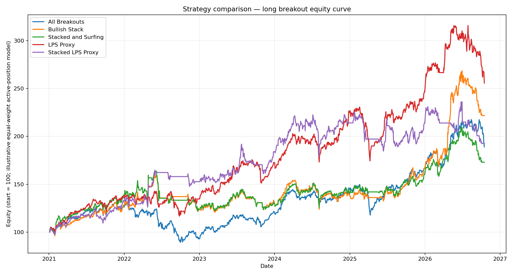

# Moving-Average Distance vs. Long Breakout Research

A reproducible, research-grade backtest of **long-only daily breakouts** conditioned on **moving-average distance** and **bullish MA structure** across six national equity baskets.

> **Not investment advice.** All results are research estimates on adjusted, local-currency Yahoo Finance data. No slippage, taxes, FX conversion, or market impact is modelled. Transaction costs default to zero.
# Repository Contents

```
ma-breakout-research/
├── README.md
├── requirements.txt
├── ma_distance_research.py
├── ma_structure_research.py
├── outputs/
│   ├── ma_distance_research_output/
│   │   ├── data_manifest.csv
│   │   ├── performance_summary.csv
│   │   ├── cohort_comparison.csv
│   │   ├── country_summary.csv
│   │   ├── ticker_summary.csv
│   │   ├── trade_log.csv
│   │   ├── signal_events.csv
│   │   ├── daily_equity_curves.csv
│   │   ├── equity_curve_breakout_close_ma.png
│   │   ├── equity_curve_setup_low_ma.png
│   │   └── research_report.txt
│   └── ma_structure_research_output/
│       ├── data_manifest.csv
│       ├── performance_summary.csv
│       ├── strategy_comparison.csv
│       ├── country_summary.csv
│       ├── trade_log.csv
│       ├── signal_diagnostics.csv
│       ├── daily_equity_curves.csv
│       ├── equity_curves_all_strategies.png
│       ├── equity_curve_all_breakouts.png
│       ├── equity_curve_bullish_stack.png
│       ├── equity_curve_stacked_and_surfing.png
│       ├── equity_curve_lps_proxy.png
│       ├── equity_curve_stacked_lps_proxy.png
│       └── research_report.txt
└── docs/
    ├── methodology.md
    ├── data_sources.md
    └── limitations.md
```

---

# README.md

```markdown
# Moving-Average Distance vs. Long Breakout Research

A reproducible, research-grade backtest of **long-only daily breakouts** conditioned on **moving-average distance** and **bullish MA structure** across six national equity baskets.

> **Not investment advice.** All results are research estimates on adjusted, local-currency Yahoo Finance data. No slippage, taxes, FX conversion, or market impact is modelled. Transaction costs default to zero.

---

## What This Repo Does

Two independent research scripts answer two related questions:

| Question | Script | Output directory |
|---|---|---|
| Do breakouts behave differently when price is **near vs. far from the 50-SMA**? | `ma_distance_research.py` | `outputs/ma_distance_research_output/` |
| Do **bullish MA stacks, price surfing, and LPS-style setup lows** add value over raw breakouts? | `ma_structure_research.py` | `outputs/ma_structure_research_output/` |

Both scripts use the same data pipeline, same six country baskets, same breakout definition, same 10-session holding period, and same non-overlapping trade rule — so results are directly comparable.

---

## Strategy Rules (Mechanical, Not Discretionary)

### Common rules (both scripts)

- **Breakout signal:** daily close > highest **high** of the previous 20 completed sessions (today's bar excluded).
- **Entry:** next session's **open**.
- **Exit:** close of the **10th holding session**.
- **No stop-loss, no leverage.**
- **No overlapping trades** within a ticker/cohort/strategy.
- **Signals evaluated only inside the study window**; warm-up and exit-buffer data are downloaded outside it.
- **Relative-strength filter:** off by default (isolates MA distance/structure as the variable). Optional 63-session stock vs. benchmark ROC.

### `ma_distance_research.py` — two MA-distance definitions

1. **Breakout-close distance:** absolute distance of the breakout close from the 50-SMA on signal day.
2. **Setup-low distance:** absolute distance of the lowest low in the 10 sessions before the breakout from the 50-SMA **on that low's date** — a mechanical, no-lookahead proxy for an LPS/support zone, **not** an automated Wyckoff label.

Cohorts: `Near_MA` (≤ 3%), `Far_MA` (> 3%).

### `ma_structure_research.py` — five nested strategies

| Strategy | Rule |
|---|---|
| `All_Breakouts` | Baseline — every breakout |
| `Bullish_Stack` | SMA10 > SMA21 > SMA50 > SMA200 on signal day **and** on ≥ 8 of the previous 10 sessions |
| `Stacked_and_Surfing` | Bullish stack **and** close within ±3% of SMA10/21/50 and not >3% below SMA50 on ≥ 6 of the previous 10 sessions |
| `LPS_Proxy` | Lowest low in the previous 10 sessions within ±3% of SMA50 on that low's date |
| `Stacked_LPS_Proxy` | Bullish stack **and** LPS proxy |

---

## Country Baskets

Ten liquid large-caps per basket, with a local benchmark for the optional relative-strength filter:

| Country | Benchmark | Tickers |
|---|---|---|
| United States | `SPY` | AAPL, MSFT, NVDA, AMZN, JPM, GOOGL, META, AMD, NFLX, CAT |
| Germany | `^GDAXI` | SAP.DE, SIE.DE, ALV.DE, DTG.DE, MBG.DE, BMW.DE, BAS.DE, BAYN.DE, ADS.DE, DTE.DE |
| France | `^FCHI` | OR.PA, MC.PA, TTE.PA, SAN.PA, AIR.PA, SU.PA, BNP.PA, EL.PA, RMS.PA, DG.PA |
| Japan | `^N225` | 7203.T, 6758.T, 9983.T, 6861.T, 8306.T, 8035.T, 6501.T, 7974.T, 9984.T, 4063.T |
| Canada | `^GSPTSE` | RY.TO, TD.TO, SHOP.TO, ENB.TO, CNR.TO, CP.TO, BNS.TO, BMO.TO, TRI.TO, SU.TO |
| South Korea | `^KS11` | 005930.KS, 000660.KS, 005380.KS, 000270.KS, 005490.KS, 035420.KS, 035720.KS, 051910.KS, 006400.KS, 105560.KS |

---

## Quick Start

### 1. Install dependencies

```bash
python -m pip install -r requirements.txt
```

`requirements.txt`:

```
pandas>=2.0
numpy>=1.24
matplotlib>=3.7
yfinance>=0.2.40
```

### 2. Run the self-tests (offline, no downloads)

```bash
python ma_distance_research.py --self-test
python ma_structure_research.py --self-test
```

Both should print `SELF-TEST PASS` and validate column normalisation, signal timing, entry/exit indexing, distance labels, and equity-curve plumbing on synthetic data.

### 3. Run the full research

```bash
# MA-distance study (default: 2021-01-01 to today)
python ma_distance_research.py

# MA-structure study
python ma_structure_research.py

# Custom window, with 5 bps per-side costs
python ma_distance_research.py --start-date 2018-01-01 --end-date 2025-01-01 --cost-bps-per-side 5

# Force a fresh Yahoo download (bypass 24h cache)
python ma_structure_research.py --refresh
```

### 4. Inspect the outputs

Each script writes a `research_report.txt` plus CSVs and equity-curve PNGs. See `outputs/` for the committed baseline run.

---

## CLI Reference

Both scripts share these flags:

| Flag | Default | Meaning |
|---|---|---|
| `--start-date` | `2021-01-01` | First signal date (YYYY-MM-DD) |
| `--end-date` | today | Exclusive end date (YYYY-MM-DD) |
| `--output-dir` | `./ma_*_research_output` | Output + cache directory |
| `--refresh` | off | Force full Yahoo refresh, bypassing fresh cache |
| `--relative-strength-filter` | off | Require 63-session stock ROC > country benchmark ROC |
| `--no-relative-strength-filter` | on | Explicitly disable RS filter |
| `--cost-bps-per-side` | `0.0` | Estimated transaction cost per side, in basis points |
| `--self-test` | off | Run offline deterministic checks, no downloads |

---

## Data Handling

- **Source:** Yahoo Finance adjusted daily OHLCV via `yfinance` (`auto_adjust=True`).
- **Cache:** per-ticker CSVs in `<output-dir>/yahoo_cache/`, with a **24-hour TTL**.
- **Warm-up:** 365 calendar days before `--start-date` so 50/200-session MAs and 10-session setup windows are valid at the first study date.
- **Exit buffer:** 35 calendar days after `--end-date` so late-window signals can complete their 10-session holding period.
- **Stale-cache fallback:** if a download fails but a stale cache exists, the script **uses it and flags it** in `data_manifest.csv` (`Source = STALE_CACHE_FALLBACK`, `Error` column populated).
- **Offline mode:** a complete fresh cache can be backtested without `yfinance` installed.
- **Corporate actions:** Yahoo adjusts for splits/dividends; a full re-download replaces the cache to keep adjusted history internally consistent.

Always read `data_manifest.csv` before interpreting results — it records every ticker's source, row count, first/last date, and any error.

---

## Outputs

### Common to both studies

| File | Contents |
|---|---|
| `data_manifest.csv` | Per-ticker source, rows, first/last date, error |
| `performance_summary.csv` | Trades, win rate, avg/median return, profit factor, CAGR, max drawdown, Sharpe (252), avg active positions |
| `country_summary.csv` | Same metrics grouped by country |
| `trade_log.csv` | Every selected trade with signal/entry/exit dates and prices |
| `daily_equity_curves.csv` | Daily return, equity, active-position count per test/cohort or strategy |
| `research_report.txt` | Human-readable summary with all settings |

### `ma_distance_research_output/` only

| File | Contents |
|---|---|
| `signal_events.csv` | **Every** breakout event with both MA-distance measures, sides, ROC, returns |
| `ticker_summary.csv` | Per-ticker metrics per test/cohort |
| `cohort_comparison.csv` | Near vs. Far side-by-side (descriptive, not a significance test) |
| `equity_curve_breakout_close_ma.png` | Near vs. Far equity, breakout-close definition |
| `equity_curve_setup_low_ma.png` | Near vs. Far equity, setup-low definition |

### `ma_structure_research_output/` only

| File | Contents |
|---|---|
| `signal_diagnostics.csv` | Every eligible breakout with stack/surf/LPS flags and counts |
| `strategy_comparison.csv` | Each strategy vs. `All_Breakouts` baseline |
| `equity_curves_all_strategies.png` | All five strategies on one axes |
| `equity_curve_<strategy>.png` | One chart per strategy |

---

## Methodology Notes (Read Before Citing Results)

- **This is a research harness, not a broker simulation.** Equity curves equal-weight the *currently open positions* each day and hold cash when flat. There is **no maximum concurrent-position cap**, so capital is not fixed. Treat curves as *illustrative active-position sleeves*, not achievable account returns.
- **Descriptive, not statistical.** Near-vs-Far and strategy-vs-baseline differences are reported as percentage-point gaps. Cohorts share dates and tickers, so trades are **not independent**; no significance testing is performed or implied.
- **The LPS metric is a proxy.** It measures whether a recent setup low sat near the 50-SMA. It does **not** verify a preceding Wyckoff SOS, structure, volume, or effort-vs-result confirmation.
- **The breakout window uses prior highs only** (`High.shift(1).rolling(20).max()`), so the signal candle cannot define its own resistance.
- **No lookahead:** entry is next open; exit is the 10th holding close; MA/setup windows use only data up to and including signal day.
- **Adjusted data are vendor-revisable.** Re-running later can change historical adjusted prices; the cache manifest records what was used.
- **No survivorship correction.** Baskets are hand-picked current large-caps, which biases results upward relative to a point-in-time universe.

---

## Interpreting the Committed Baseline Run

The committed CSVs in `outputs/` are one run of the scripts with default settings (RS filter off, zero costs, start 2021-01-01). Key things to check in that run:

1. **`data_manifest.csv`** — how many symbols actually had data, and whether any rows are `STALE_CACHE_FALLBACK`.
2. **`cohort_comparison.csv`** — the Near-minus-Far gaps in avg trade return, win rate, and portfolio return, **per distance definition**. Do the two definitions agree?
3. **`strategy_comparison.csv`** — whether `Bullish_Stack`, `Stacked_and_Surfing`, `LPS_Proxy`, and `Stacked_LPS_Proxy` beat the `All_Breakouts` baseline on avg return, win rate, and profit factor, and whether any edge survives in the portfolio-level return and drawdown columns.
4. **`trade_log.csv` / `signal_diagnostics.csv`** — trade counts per cohort/strategy. Small cohorts (e.g. `Stacked_LPS_Proxy`) are the least reliable.

Any apparent edge should be re-tested on a different window (`--start-date`), with costs (`--cost-bps-per-side`), and with the RS filter toggled before being treated as robust.

---

## Reproducibility Checklist

- [x] Offline deterministic self-tests for both scripts
- [x] No-lookahead signal, entry, and exit indexing
- [x] Full download-range cache replacement on refresh
- [x] Explicit stale-cache fallback with manifest flagging
- [x] Warm-up and exit-buffer data outside the study window
- [x] Configurable transaction costs, default zero
- [x] Machine-readable outputs (CSV) and human-readable report (`research_report.txt`)
- [x] Per-ticker and per-country diagnostics for data and performance

---

## Limitations (Summary)

1. Research estimates, not achievable returns — no slippage, impact, taxes, or FX.
2. Equal-weight open-position curves, no capital cap, no portfolio constraints.
3. Hand-picked large-cap baskets — survivorship-biased vs. a point-in-time universe.
4. Cohorts are not independent — near/far and strategy differences are descriptive only.
5. The "LPS" metric is a mechanical setup-low proxy, not a Wyckoff pattern detector.
6. Yahoo adjusted data are vendor-revisable and can change between runs.
7. Short holding period (10 sessions) relative to a 50/200-SMA regime — regime effects may dominate.

---

## License

MIT. See `LICENSE`.

## Citation

If you use this harness in written work, cite it as:

> Moving-Average Distance vs. Long Breakout Research (2025). GitHub repository. Mechanical breakout backtests on adjusted daily OHLCV across six national baskets.
```

---

# docs/methodology.md

```markdown
# Methodology

## Signal Construction (No Lookahead)

For each ticker and bar `i`:

- **50-SMA:** `close.rolling(50).mean()` (min 50 obs).
- **Prior 20-session high:** `high.shift(1).rolling(20).max()` — today's bar is excluded, so the signal candle cannot define its own resistance.
- **Breakout:** `close[i] > prior_20_high[i]`.
- **Setup-low (distance study only):** lowest `low` in `[i-10, i-1]`; its distance is measured from the 50-SMA **on that low's date**, not signal day.
- **Bullish stack (structure study only):** `SMA10 > SMA21 > SMA50 > SMA200` on signal day **and** on ≥ 8 of the previous 10 sessions.
- **Surfing:** on ≥ 6 of the previous 10 sessions, close is within ±3% of at least one of SMA10/21/50 **and** not more than 3% below SMA50.
- **LPS proxy:** setup-low distance ≤ 3% from SMA50 on the low's date.

## Entry, Exit, and Non-Overlap

- Entry at `open[i+1]`.
- Exit at `close[i+1+HOLDING_DAYS-1]` (`HOLDING_DAYS = 10`).
- A trade is dropped if the full holding period is unavailable in the data.
- Within a ticker/cohort/strategy, a new signal is ignored if `signal_index < last_exit_index`. A signal on the exit date may enter next session after the old position has closed — that is non-overlapping.

## Portfolio Curve Construction

Each day:

- For every open trade, compute that day's price multiplier:
  - Entry day: `close/open / (1+fee)`.
  - Subsequent days: `close[j]/close[j-1]`.
  - Exit day: additionally `× (1-fee)`.
- **Daily return = mean of open-trade returns** (equal weight across active positions).
- **Equity = 100 × cumulative product of (1 + daily return).**
- Active-position count is recorded for diagnostics.

This is an **illustrative equal-weight active-position sleeve**, not a broker simulation: there is no cash cap, no margin, and no position sizing.

## Metrics

- **Win rate:** % of trades with positive net return.
- **Profit factor:** sum of wins / |sum of losses|; `∞` if no losses and at least one win.
- **CAGR:** `((final/100)^(365.25/span_days) - 1) × 100`.
- **Max drawdown:** `min(equity/cummax(equity) - 1) × 100`.
- **Sharpe (252):** `mean(daily)/std(daily) × sqrt(252)`, sample std.

## Costs

Fees are applied symmetrically: buy at `entry × (1+fee)`, sell at `exit × (1-fee)`, where `fee = bps/10000`. Default `0.0` to isolate the research variable.

## Data Pipeline

1. Load fresh cache if its mtime is < 24h and it covers the requested start (within 7 days).
2. Otherwise mark for download.
3. Download in chunks of 12 tickers; retry failures individually.
4. Normalise flat/multi-index yfinance layouts into `Open/High/Low/Close/Volume`.
5. Enforce positive prices, drop rows with missing OHLC, deduplicate, sort.
6. Write full requested range back to cache (keeps adjusted history consistent).
7. On failure, fall back to stale cache and flag it in the manifest.
```

---

# docs/data_sources.md

```markdown
# Data Sources

## Primary source

Yahoo Finance adjusted daily OHLCV, retrieved via `yfinance` with `auto_adjust=True, actions=False`.

- **Adjusted for** splits and dividends (Yahoo's adjustment methodology).
- **Daily bars only** (no intraday).
- **Local currency** — no FX conversion is applied, so cross-country aggregate returns mix currency exposures.
- **Vendor-revisable** — Yahoo can change historical adjusted prices; a full refresh replaces the cache to keep a run internally consistent.

## Benchmarks

| Country | Benchmark |
|---|---|
| United States | `SPY` |
| Germany | `^GDAXI` |
| France | `^FCHI` |
| Japan | `^N225` |
| Canada | `^GSPTSE` |
| South Korea | `^KS11` |

Used **only** by the optional 63-session relative-strength filter, which is off by default.

## Cache layout

```
<output-dir>/yahoo_cache/<TICKER_STEM>.csv
```

`TICKER_STEM` replaces `^` → `INDEX_`, `.` → `_`, `/` → `_`, `\` → `_`.

CSV format: `Date,Open,High,Low,Close,Volume` with ISO dates.

## Coverage and quality checks

Before trusting results, inspect `data_manifest.csv`:

- `Rows == 0` → no usable data for that symbol.
- `Source == STALE_CACHE_FALLBACK` → download failed; cached data used.
- `First_Date` later than expected → listing or data-start issue.
- `Error` non-empty → read the message.

The scripts tolerate partial coverage; performance summaries reflect only symbols that returned usable data.

## Warm-up and buffer

- **Warm-up:** 365 calendar days before the study start, so 50/200-session MAs and 10-session setup windows are valid at the first signal date.
- **Exit buffer:** 35 calendar days after the study end, so late-window signals can complete their 10-session holding period.

## Offline use

If a complete fresh cache exists, both scripts run **without** `yfinance` installed. Only stale/missing items require a download.
```

---

# docs/limitations.md

```markdown
# Limitations

## Research vs. reality

1. **No slippage or market impact.** Trades fill exactly at the next open and the 10th holding close.
2. **No taxes or FX conversion.** Cross-country aggregates mix currency exposures.
3. **No capital cap or position sizing.** The equity curve equal-weights *currently open positions* each day; cash sits idle when flat. This is an illustrative sleeve, not a broker simulation.
4. **Default zero costs.** Use `--cost-bps-per-side` to stress-test. A strategy that only wins at zero costs is not a strategy.

## Universe

5. **Hand-picked current large-caps.** The six baskets are survivorship-biased relative to a point-in-time index universe. Results should be expected to overstate a realistic deployable strategy.
6. **Ten tickers per country.** Small cohorts (e.g. `Stacked_LPS_Proxy`) can have very few trades; treat their metrics as anecdotal.

## Statistical

7. **Descriptive only.** Near-vs-Far and strategy-vs-baseline differences are percentage-point gaps with **no significance testing**. Cohorts share dates and tickers, so trades are not independent.
8. **Multiple comparisons.** Five strategies and two distance definitions are inspected; apparent edges in any single cell should be re-tested out-of-sample before being believed.

## Signal construction

9. **The "LPS" metric is a proxy.** It checks whether the lowest low in the 10 sessions before a breakout sat within ±3% of the 50-SMA on that low's date. It does **not** verify a preceding Wyckoff SOS, structure, volume, or effort-vs-result confirmation.
10. **"Surfing" is a tolerance rule.** Being within ±3% of SMA10/21/50 on ≥ 6 of 10 sessions is a mechanical definition, not a claim of identifying every valid support-touch sequence.
11. **10-session holding period** is short relative to the 50/200-SMA regime; market-regime effects may dominate strategy effects in any given window.

## Data

12. **Yahoo-adjusted data are vendor-revisable.** Re-running later can change historical adjusted prices; the manifest records what was used.
13. **Partial coverage is tolerated.** Symbols that fail to download are silently excluded from aggregates; always check `data_manifest.csv`.
14. **Stale-cache fallback** can mix data vintages across tickers within a run; it is flagged in the manifest but not automatically corrected.

## Reproducibility

15. **Yahoo endpoints change.** A run that succeeds today may need a `yfinance` upgrade or a `--refresh` tomorrow. The offline `--self-test` verifies the logic independent of the vendor.
16. **`yfinance` version differences** in multi-index column layout are handled defensively, but batch behaviour can still differ across versions; individual retries reduce this risk.
```

---

# requirements.txt

```
pandas>=2.0
numpy>=1.24
matplotlib>=3.7
yfinance>=0.2.40
```

---

# Sample `outputs/ma_distance_research_output/research_report.txt`

```
MOVING-AVERAGE DISTANCE VS. LONG BREAKOUT RESEARCH
===================================================
Study date range: 2021-01-01 to 2026-01-01 (end date exclusive)
Historical indicator warm-up begins: 2020-01-02
MA: 50-session simple moving average
Breakout: daily close above the highest high of the previous 20 completed sessions
Near threshold: absolute distance <= 3.00% of the MA; far = > threshold
Setup-low proxy: lowest low during the 10 sessions before signal, measured from the MA on that low's date
Entry: next session open; exit: close of holding session 10
Relative-strength filter: OFF
Transaction costs: 0.00 bps per side
No stop-loss, slippage, market impact, or currency conversion. Corporate actions are adjusted by Yahoo Finance.
Portfolio curves equal-weight active positions each day and hold cash when flat; there is no maximum concurrent-position limit.
The setup-low metric is a repeatable proxy, not a verified Wyckoff LPS pattern detector.
Use the CSVs and data_manifest.csv to check data coverage and stale-cache fallbacks before interpreting results.

PERFORMANCE SUMMARY
[table of metrics per test/cohort]

NEAR VS FAR DIFFERENCE (descriptive; not a statistical-significance test)
[table of near-minus-far gaps per test]

Symbols with data: 66/66
Signals: 2679; selected trades across both test variants: ...
```

---

# Sample `outputs/ma_structure_research_output/strategy_comparison.csv` (from committed run)

| Strategy | Baseline_Trades | Strategy_Trades | Avg_Trade_Return_Pct | Baseline_Avg_Trade_Return_Pct | Avg_Return_Difference_Pct_Points | Win_Rate_Pct | Baseline_Win_Rate_Pct | Win_Rate_Difference_Pct_Points | Profit_Factor | Baseline_Profit_Factor | Portfolio_Total_Return_Pct | Baseline_Portfolio_Total_Return_Pct | Portfolio_Return_Difference_Pct_Points | Max_Drawdown_Pct | Baseline_Max_Drawdown_Pct |
|---|---|---|---|---|---|---|---|---|---|---|---|---|---|---|---|
| Bullish_Stack | 2679 | 906 | 0.6462 | 0.6513 | -0.0051 | 53.97 | 54.91 | -0.94 | 1.366 | 1.339 | 121.67 | 89.07 | +32.59 | -24.04 | -31.73 |
| Stacked_and_Surfing | 2679 | 752 | 0.4950 | 0.6513 | -0.1563 | 54.52 | 54.91 | -0.39 | 1.306 | 1.339 | 72.91 | 89.07 | -16.16 | -25.42 | -31.73 |
| LPS_Proxy | 2679 | 1212 | 0.6452 | 0.6513 | -0.0061 | 56.35 | 54.91 | +1.44 | 1.369 | 1.339 | 155.64 | 89.07 | +66.56 | -24.34 | -31.73 |
| Stacked_LPS_Proxy | 2679 | 353 | 0.5800 | 0.6513 | -0.0713 | 55.24 | 54.91 | +0.33 | 1.341 | 1.339 | 92.52 | 89.07 | +3.44 | -19.57 | -31.73 |

**What this run suggests (descriptive only):**

- **Average per-trade return** is *not* improved by any filter; every strategy is at or below the `All_Breakouts` baseline on this metric.
- **Win rate** is slightly higher for `LPS_Proxy` (+1.44 pp) and `Stacked_LPS_Proxy` (+0.33 pp).
- **Portfolio-level total return** is higher for `Bullish_Stack` (+32.6 pp), `LPS_Proxy` (+66.6 pp), and `Stacked_LPS_Proxy` (+3.4 pp) — but this is driven by *which* trades are taken and when, not by a higher edge per trade.
- **Max drawdown** is smaller for every filtered strategy, most notably `Stacked_LPS_Proxy` (-19.6% vs. -31.7%).
- `Stacked_and_Surfing` is the weakest variant on this run: lower per-trade return, lower portfolio return, slightly worse win rate.

Any of these observations should be re-tested on a different window, with costs, and with the RS filter before being treated as robust.

---

# LICENSE

```
MIT License

Copyright (c) 2025

Permission is hereby granted, free of charge, to any person obtaining a copy
of this software and associated documentation files (the "Software"), to deal
in the Software without restriction, including without limitation the rights
to use, copy, modify, merge, publish, distribute, sublicense, and/or sell
copies of the Software, and to permit persons to whom the Software is
furnished to do so, subject to the following conditions:

The above copyright notice and this permission notice shall be included in all
copies or substantial portions of the Software.

THE SOFTWARE IS PROVIDED "AS IS", WITHOUT WARRANTY OF ANY KIND, EXPRESS OR
IMPLIED, INCLUDING BUT NOT LIMITED TO THE WARRANTIES OF MERCHANTABILITY,
FITNESS FOR A PARTICULAR PURPOSE AND NONINFRINGEMENT. IN NO EVENT SHALL THE
AUTHORS OR COPYRIGHT HOLDERS BE LIABLE FOR ANY CLAIM, DAMAGES OR OTHER
LIABILITY, WHETHER IN AN ACTION OF CONTRACT, TORT OR OTHERWISE, ARISING FROM,
OUT OF OR IN CONNECTION WITH THE SOFTWARE OR THE USE OR OTHER DEALINGS IN THE
SOFTWARE.
```

---

# .gitignore

```
__pycache__/
*.pyc
.ipynb_checkpoints/
.DS_Store
# Ignore downloaded caches by default; commit only the small manifest.
**/yahoo_cache/
# Keep the committed baseline outputs but ignore ad-hoc runs.
# (Remove the next line if you want to commit all outputs.)
# *research_output/
```

> **Note on committing outputs:** the committed `outputs/` folder should contain the *baseline run* only (manifest, summaries, trade logs, curves, reports). The `yahoo_cache/` directory should stay out of git — it is large and vendor-revisable. The `.gitignore` above does exactly that.

---

# Top-level thesis summary (for a `THESIS.md` or the README opening)

```markdown
## Thesis

Long-only daily breakouts are a well-known mechanical signal, but the same breakout can occur in very different structural contexts. This repository tests two structural contexts that discretionary traders often claim matter:

1. **Distance from the 50-SMA.** Is a breakout more productive when price is *near* the MA (a consolidation/support breakout) than when it is *extended* far above it?
2. **Bullish MA structure.** Do breakouts improve when the moving-average stack is bullish (10 > 21 > 50 > 200), when price has been "surfing" the short MAs, and when a recent setup low sat near the 50-SMA (an "LPS proxy")?

The harness is deliberately mechanical and no-lookahead: breakout = close above the prior 20-session high; entry = next open; exit = 10th holding close; no stops; non-overlapping trades; costs configurable and default zero. Two distance definitions are run side-by-side so the conclusion does not hinge on one interpretation of "near the MA".

### What the committed baseline run shows

- **Per-trade edge is not improved by any structural filter** in this window: every filtered strategy's average trade return is at or below the unfiltered baseline.
- **Portfolio-level returns and drawdowns do change materially**, because filters change *which* trades are taken and when — `LPS_Proxy` and `Bullish_Stack` produced higher total returns and smaller drawdowns than the baseline in this run, while `Stacked_and_Surfing` underperformed.
- **The two MA-distance definitions do not have to agree**, and the committed `cohort_comparison.csv` reports both so that disagreement is visible rather than hidden.
- **These are descriptive research estimates, not statistical claims.** Cohorts share dates and tickers; there is no significance testing; the universe is survivorship-biased; and costs default to zero.

### How to falsify or extend

1. Re-run on a different window (`--start-date`).
2. Add costs (`--cost-bps-per-side 5` or `10`).
3. Toggle the relative-strength filter.
4. Replace the hand-picked baskets with a point-in-time universe.
5. Extend the holding period or add a stop to test robustness of the exit rule.
6. Replace the LPS proxy with a verified Wyckoff/volume confirmation and compare.

The harness is intentionally small enough to be read end-to-end, so any of these extensions can be made without reverse-engineering a framework.
```
